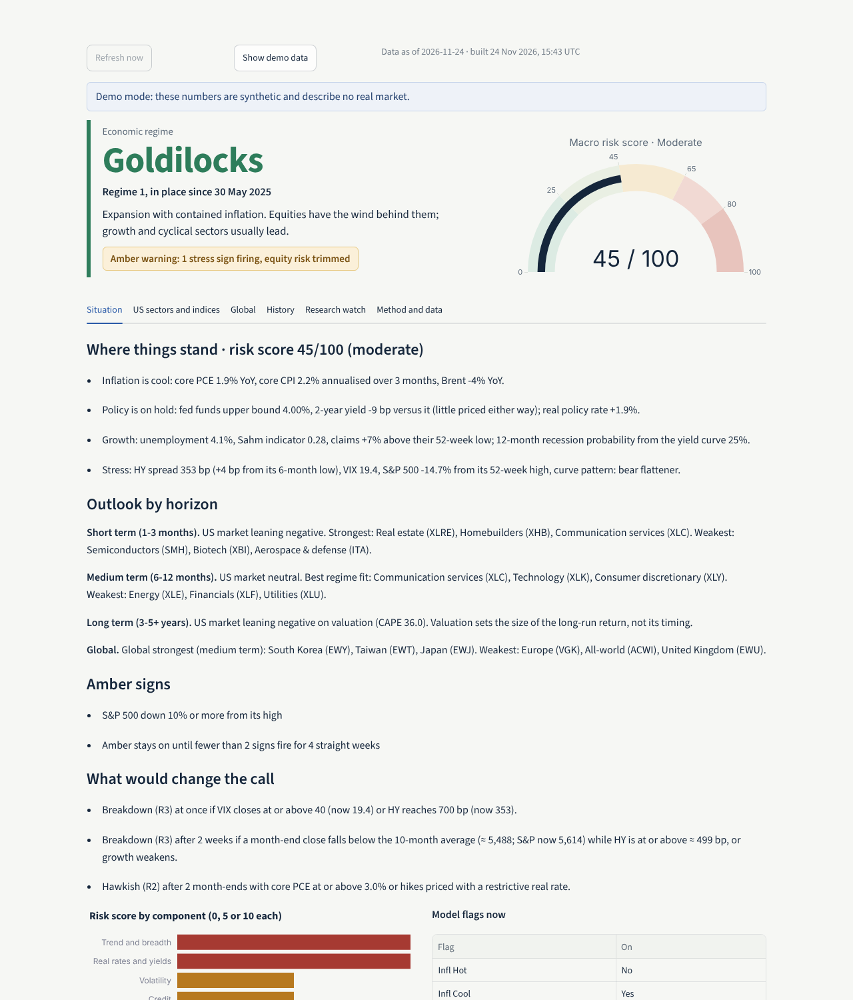

# Macro Navigator

Where the economy stands and what it means for the S&P 500, the Nasdaq and any S&P 500 or Nasdaq 100 stock,
over 1–3 months, 6–12 months and 3–5 years. Built from free data, tested against history, and served as a
private app that opens in about a second on your phone or Mac. Nothing has to stay running on your side:
GitHub does the work on a schedule and Cloudflare serves the result.

## Cloud app: one-time setup (about 20 minutes)

You need four free accounts or keys: **GitHub**, **Cloudflare**, a **FRED key** (you have it) and a **Gemini key**.

### 1. Put the project on GitHub
1. Go to github.com, sign in, click **New** (top left) to create a repository. Name it `macro-navigator`,
   choose **Private**, click **Create repository**.
2. On the empty repository page, click **uploading an existing file**.
3. In Finder, open the unzipped `macro-navigator` folder and press **Cmd + Shift + .** so hidden items such as
   the `.github` folder show. Select everything inside the folder and drag it onto the GitHub page.
4. Click **Commit changes**.

### 2. Get your Cloudflare details
1. Sign up at dash.cloudflare.com (free plan, no card needed for Pages).
2. **Account ID**: optional. The workflow finds it from your API token and prints it in the run log.
3. **API token**: click the person icon (top right) → **My Profile** → **API Tokens** → **Create Token** →
   **Create Custom Token**. Name it `macro-navigator`. Permission: **Account · Cloudflare Pages · Edit**.
   Account resources: your account. Click **Continue to summary** → **Create Token** and copy it.

### 3. Save the keys in GitHub (the only place you keep them)
In your repository: **Settings → Secrets and variables → Actions → New repository secret**. Add:

| Name | Value |
| --- | --- |
| `FRED_API_KEY` | your FRED key |
| `GEMINI_API_KEY` | from aistudio.google.com → **Get API key** → **Create API key** |
| `CLOUDFLARE_API_TOKEN` | the token from step 2 |
| `CLOUDFLARE_ACCOUNT_ID` | optional; leave it out and the workflow finds it |
| `REFRESH_TOKEN` | optional, for the app's Refresh and Add-to-watchlist buttons: github.com → your photo → **Settings → Developer settings → Personal access tokens → Fine-grained tokens → Generate new token**. Repository access: **Only select repositories → macro-navigator**. Permissions: **Actions: Read and write**, **Contents: Read and write**. |

### 4. First run
Repository → **Actions** → **Publish** → **Run workflow**. The first run downloads the full history and
takes about 10–15 minutes; later runs take about 5–8. When it finishes, open the **4 · Deploy** step: the last
lines show your app's address, such as `https://macro-navigator.pages.dev`.

### 5. Make it private (required for chat, refresh and watchlist)
1. Cloudflare dashboard → **Zero Trust**. The first time, pick a team name and the **Free** plan.
2. **Access → Applications → Add an application → Self-hosted**.
3. Application domain: your app's address from step 4, without `https://`. Save the application details.
4. Add a policy: Action **Allow**, Include **Emails**, your email address. Save.
Now the app asks for your email and sends you a one-time code. The chat, refresh and watchlist buttons stay
switched off until this is done, so nobody else can use your Gemini key.

### 6. On your phone
Open the address in Safari, log in with the emailed code, then **Share → Add to Home Screen**.

### Stock pages: earnings and company financials
Each stock page shows an Earnings card (SEC results dates, typical results-day move, estimated next date) and a Company
financials card (first-reported SEC figures). Both are information, not signals: see "Tested and rejected" on the
S&P 500 tab. The first run after this update downloads SEC filings once (about 10-15 minutes extra); later runs refresh
a slice each day.

### Using it
- **One tap** opens the latest run. Data refreshes by itself every weekday at 22:30 UTC (after the US close).
- **Refresh** starts a new run; new data in about 5–8 minutes.
- **Search** any S&P 500 or Nasdaq 100 stock, an index, or a sector ETF. Anything else: **Add to watchlist**,
  and it appears after the next refresh (the list lives in `config/watchlist.txt`).
- **Ask** answers with Gemini from your data only, shows what it looked up, and checks every number against
  the data before showing it. Without a Gemini key (or past the free quota) it gives a rule-based answer.
- Free-tier use: a weekday run takes about 6–8 GitHub minutes, well inside the 2,000 free minutes a month for
  private repositories. Cloudflare serves the pages free; chat uses a few requests per question.

The Mac launcher below still works as an offline backup.

---


One page that tells you where the economy stands and what it means for US sectors, indices and global
markets over three horizons: 1–3 months, 6–12 months and 3–5+ years. It runs on free public data, updates
itself every trading day, and opens on your phone or Mac.



## What you get

- **Economy**: the regime (for example "Late cycle, held back by inflation"), four pillars (growth, inflation,
  policy, credit), where today sits versus history, recession odds, and the readings that would change the read.
- **S&P 500**: the stance (Normal, Elevated risk, High risk or Recovery window) from signals that held up in both
  halves of history, the direction for each horizon with an evidence tag, the re-entry triggers and how far
  away they are, the most similar past periods, and the models' out-of-sample track record.
- **Nasdaq and any stock**: five layers (economy, market, sector, own trend, SEC fundamentals) marked tailwind or
  headwind, the direction per horizon, how much market risk it carries, how it behaved in past months like now,
  and what would flip the view.
- **Ask**: plain-language answers from Gemini, grounded in the same data and number-checked.

## How it works

```
GitHub (your private repo)
  └─ Actions "Publish": every weekday 22:30 UTC, or Refresh / Run workflow
        1 fetch FRED, Yahoo Finance and research files (history kept between runs)
        2 evidence check + market engine (signals tested against S&P 500 history since 1927)
        3 build the app: economy, S&P 500 stance, a view for every S&P 500 / Nasdaq 100 stock (SEC fundamentals)
        4 deploy to Cloudflare Pages
              │
              ▼
Cloudflare (free): serves the pre-built app instantly, behind your email login (Access)
  └─ small functions: Ask (Gemini, numbers checked), Refresh, Add to watchlist
              │
              ▼
Your phone (home-screen icon) and your Mac (any browser)
```

## Optional: the original Streamlit dashboard

`app.py` (the regime dashboard from the playbook) still runs locally:

```bash
cd macro-navigator
python3 -m venv .venv && source .venv/bin/activate
pip install -r requirements.txt
streamlit run app.py
```

The cloud app above replaces the earlier Streamlit Cloud deployment and its daily-snapshot workflow.

## One click on your Mac

Double-click **Run Macro Navigator.command** (it runs `macro_navigator.sh`, so updates never need re-approval). It finds a
Python setup that runs the data libraries without crashing: your python3, then a fresh private copy, then a separate
Python 3.12 downloaded with uv, then a version without pyarrow; each must pass a quick test first and any setup that
crashes is blocked and retried automatically. It asks once for your FRED key and stores it in your Mac Keychain, fetches every dataset (only new rows
after the first run), scores the signals and opens the evidence report in your browser.

First time only, because macOS blocks downloaded scripts, run this line in Terminal from the folder holding the file:

```
chmod +x "Run Macro Navigator.command" && xattr -d com.apple.quarantine "Run Macro Navigator.command"
```

If macOS still says it cannot verify the file, open *System Settings → Privacy & Security* and choose
**Open Anyway**. Then drag the file onto the right-hand side of your Dock: from then on it is one click.
A rejected FRED key is removed automatically so the next run asks again; the full log is in `data/last_run.log`.

## Fetch all the research data and check the evidence (Mac terminal)

Two scripts download every dataset behind the analysis and show how each signal actually performed.

```bash
cd macro-navigator
pip install -r requirements.txt
export FRED_API_KEY="your-key"           # optional but faster; without it FRED's public CSV is used
python3 scripts/fetch_all.py             # first run: full history; later runs: only new rows
python3 scripts/evidence_check.py        # scorecard in the terminal, saved to data/store/
```

**What `fetch_all.py` downloads, all in parallel:** 65 FRED series (inflation, rates, labour, credit, liquidity,
commodities; some from 1919), 97 Yahoo tickers (S&P 500 since 1927, VIX, sectors, industries, countries, bonds,
commodities, FX), Shiller's 1871- dataset with CAPE, Ken French industry and factor returns since 1926, the Fed's
excess bond premium since 1973, the NY Fed supply-chain index, and the BoE and ECB policy rates. It writes one
file per series plus two ready-made tables, `panel_daily` and `panel_monthly`, and a `catalog.csv` listing every
series with its first and last date, row count and status.

**Why it is fast:** every source downloads at the same time over pooled connections; re-runs fetch only recent
rows (with a short overlap to catch revisions); research files are skipped if downloaded in the last 20 hours;
Yahoo tickers are re-pulled in full only when a dividend or split changed their adjusted history. The script
prints how long each source took.

**Options:** `--full` rebuilds everything (the archived ICE credit spreads are never deleted), `--only fred,files`
fetches a subset, `--vintages` adds ALFRED first-release values for revised series, `--breadth` adds the current
S&P 500 members (survivorship-biased: today's members only).

**Manual extras:** put the Goyal-Welch predictor workbook (`PredictorData*.xlsx`, from
sites.google.com/view/agoyal145) or a copy of Shiller's `ie_data.xls` into `data/manual/` and re-run.

**What `evidence_check.py` shows:** for 14 signals from the booklet (curve inversion, recession probability, Sahm
rule, credit widening, excess bond premium, trend, inflation surge, Fed tightening, oil shock, VIX stress,
supply-chain pressure, CAPE, and two regime proxies), it compares what the S&P 500 did in the 12 months after
months when the signal was on versus off: average return, share of positive outcomes, worst dip, number of
separate episodes, whether it is on today, and a verdict that requires the effect to hold in both halves of
history. Macro data are lagged to their publication dates. `data/store/` stays on your Mac and is not committed.

## Change what it covers or how it judges

- Add or remove tickers in `config/universe.yaml` (Yahoo Finance symbols).
- Change any threshold in `config/thresholds.yaml`. The defaults come from the Playbook.
- Add policy events (new facilities, QE, QT ending) in `config/events.yaml`. They count as a pivot for 60 days.
- Add research feeds or keywords in `config/research.yaml`.
- Log every change in `docs/MODEL_CHANGES.md`.

## What it does not cover yet

| Gap | Why | Workaround in place |
| --- | --- | --- |
| ISM PMI, Conference Board LEI | Licensed data | Philadelphia Fed index and building permits |
| Full S&P 500 breadth, Zweig thrust | Needs constituent-level data | Share of sector ETFs above their 200-day average |
| Long HY spread history | FRED keeps only 3 years since April 2026 | The job archives every day in `data/archive/` |
| Sector and country valuations | No free feed | Long-term view shown for US indices; add country CAPEs by hand in `thresholds.yaml` |
| Real-time data vintages | Simpler first version | Publication lags are applied; revised data are used |

Yahoo Finance data come through the unofficial `yfinance` library, which can break or be rate-limited; a
Stooq fallback covers US ETFs. If prices fail, the report lists the problem and the macro side still runs.

## Troubleshooting

- **"4 · Deploy" fails with an authentication error**: the Cloudflare token needs *Account · Cloudflare Pages ·
  Edit*, and `CLOUDFLARE_ACCOUNT_ID` must be the account ID (not the token).
- **Chat, Refresh or Add to watchlist say "locked"**: finish setup step 5 (Cloudflare Access).
- **Refresh says GitHub refused (403 or 404)**: the `REFRESH_TOKEN` must cover this repository with Actions and
  Contents set to *Read and write*.
- **Workflow fails at "1 · Fetch data" with a FRED error**: the secret name must be exactly `FRED_API_KEY`.
- **Workflow fails at "Commit"**: step 5 (read and write permissions) is not set.
- **Old action versions flagged**: bump the `@v5` / `@v6` numbers in `.github/workflows/publish.yml`.
- **Dashboard shows an old date**: press Refresh now, or check the Actions tab for a failed run.
- **Tests**: `pytest -q` runs offline on synthetic data, and the daily job runs them before every build.

Research framework, not investment advice.
